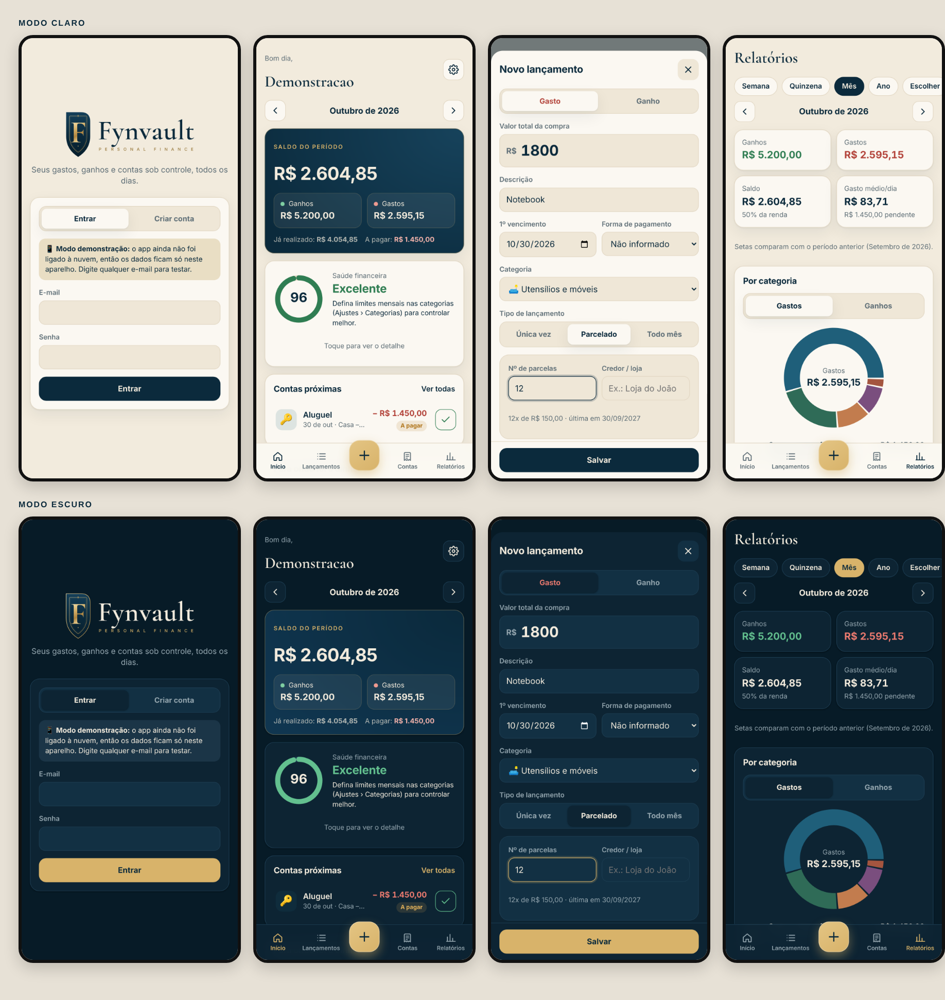

<p align="center"></p>

# Fynvault

**Personal finance** · app de finanças pessoais para **Android e iPhone**, com conta própria (e-mail e senha) e dados guardados na nuvem: se você trocar ou perder o celular, não perde nada.

## O que o app faz

| Tela | Para que serve |
|---|---|
| **Início** | Saldo do mês, ganhos × gastos, **índice de saúde financeira (0 a 100)** com dicas, contas atrasadas e próximas, gráfico de para onde foi o dinheiro e limites por categoria. |
| **+ (botão central)** | Lança um gasto ou ganho em segundos: à vista, **parcelado / promissória** (gera todas as parcelas) ou **todo mês** (conta fixa). |
| **Lançamentos** | Histórico completo com busca e filtros por período, tipo, categoria, forma de pagamento e situação (pago/pendente). |
| **Contas** | **A pagar** (atrasadas, próximos 7 dias, mês, próximos meses) · **Parcelas** (cada compra parcelada com progresso, quanto falta, quitar tudo) · **Fixas** (aluguel, luz, água, internet, salário… lançadas sozinhas todo mês). |
| **Relatórios** | **Semana, quinzena, mês, ano ou qualquer período**: destaques comparados ao período anterior ("sua conta de luz subiu 18%"), gastos por categoria e subcategoria, essencial × supérfluo, evolução, últimos 6 meses, formas de pagamento e maiores gastos. Exporta **PDF** com a marca Fynvault, **planilha Excel (.xlsx)** ou **resumo para WhatsApp**. |
| **Metas** | Metas de economia com progresso, previsão de quando você chega lá, quanto guardar por mês para cumprir o prazo, gráfico da evolução e histórico de aportes. |
| **Primeiro acesso** | Onboarding: perfil (nome e foto/emoji), rendas fixas, gastos fixos (com modelos prontos; fixos ou variáveis) e meta de economia. |
| **Lembretes** | Notificações no celular, mesmo com o app fechado: informar valor das contas variáveis (diário, de 10 a 3 dias antes), alerta crítico 2 dias antes, aviso no dia, alerta diário de conta vencida até pagar e lembrete mensal do aporte na meta. Horário configurável. |
| **Offline** | Funciona **sem internet**: tudo fica numa cópia no celular e é enviado sozinho quando a conexão volta, **sem duplicar**. Em dois aparelhos, vale a edição mais recente e exclusões chegam no outro. Comprovantes e foto do perfil pedem internet. |
| **Segurança** | Bloqueio do app por **PIN** (4 ou 6 números) e **digital / Face ID**, pedido ao abrir e ao voltar (imediatamente, após 1 ou 5 minutos). O PIN fica só no celular, no armazenamento seguro do sistema, como hash. |
| **Ajustes** | Perfil, lembretes, segurança, aparência (automático, claro ou escuro) e controle total: criar, renomear, mudar ícone/cor, reordenar, arquivar ou excluir **categorias e subcategorias**; marcar cada uma como essencial, supérfluo ou investimento; definir **limite mensal**; editar formas de pagamento; backup; trocar senha. |

Categorias que já vêm prontas (todas editáveis): Casa – contas fixas, Compras para casa, Carro (combustível, conserto, seguro/IPVA…), Fast food e delivery, Shopping e roupas, Besteiras, Promissórias e parcelas, Saúde, Lazer, Educação, Investimentos, e categorias de ganhos (Salário, Renda extra, Vendas…).

### Como funciona o índice de saúde financeira

| Fator | Peso | Ideal |
|---|---|---|
| Sobra do mês | 35 | guardar 20% ou mais do que ganha |
| Gastos supérfluos | 20 | até 10% dos gastos |
| Parcelas comprometidas | 20 | até 10% da renda nos próximos 3 meses |
| Contas em dia | 15 | nenhuma atrasada |
| Limites de gasto | 10 | nenhum limite estourado |

---

## Como colocar no ar (passo a passo)

Você vai precisar de duas contas gratuitas: **Supabase** (onde ficam seus dados) e **GitHub** (que monta o app Android para você).

### 1. Criar o banco de dados (Supabase) — uns 10 minutos

1. Entre em **https://supabase.com**, clique em **Start your project** e crie a conta.
2. Clique em **New project**, dê um nome (ex.: `fynvault`), crie uma senha forte para o banco e escolha a região **South America (São Paulo)**.
3. Com o projeto criado, abra **SQL Editor** (menu da esquerda) › **New query**.
4. Rode as migrations **em ordem**, uma de cada vez: abra `supabase/migrations/0001_inicial.sql`, copie **todo** o conteúdo, cole no editor e clique em **Run** (deve aparecer "Success"). Depois faça o mesmo com `0002_perfil_onboarding_metas.sql`, e assim por diante.
5. **Recuperação de senha por código:** vá em **Authentication › Emails** (ou *Email Templates*) › **Reset Password** e troque o texto por:
   ```
   <h2>Recuperar senha</h2>
   <p>Seu código para criar uma nova senha no Fynvault é: <b>{{ .Token }}</b></p>
   ```
6. *(Opcional, deixa mais simples)* Em **Authentication › Sign In / Providers › Email**, desligue **Confirm email**. Assim a conta já funciona na hora, sem precisar abrir o link de confirmação.
7. Vá em **Project Settings › API** (ou **Data API**) e anote:
   - **Project URL** (algo como `https://abcdxyz.supabase.co`)
   - **anon public key** (um texto longo começando com `eyJ...`)

### 2. Gerar o app Android (GitHub) — uns 10 minutos

1. Crie uma conta em **https://github.com** e um repositório **privado** novo (ex.: `fynvault`).
2. Envie todos os arquivos deste projeto para o repositório.
3. No repositório, vá em **Settings › Secrets and variables › Actions › New repository secret** e crie dois:
   - `VITE_SUPABASE_URL` = a Project URL do passo 1
   - `VITE_SUPABASE_ANON_KEY` = a anon public key do passo 1
4. Vá na aba **Actions**, escolha **Gerar APK Android** › **Run workflow**. Em uns 5 minutos fica pronto.
5. No celular Android, abra o repositório no GitHub › **Releases** › baixe **Fynvault.apk** e toque nele para instalar.
   O Android vai pedir para **permitir instalar apps desta fonte**. Permita (é o seu próprio app).
6. Abra o app, toque em **Criar conta**, e pronto!

Sempre que o código mudar, o GitHub gera uma nova versão sozinho. É só baixar e instalar por cima (seus dados ficam na nuvem).

### 3. iPhone (iOS)

A Apple só permite instalar apps no iPhone por meio dela. Há dois caminhos:

- **Com um Mac (grátis):** instale o **Xcode**, rode `npm install`, `npm run build`, `npx cap sync ios` e `npx cap open ios`. Conecte o iPhone, escolha seu Apple ID em *Signing & Capabilities* e clique em ▶︎. Com conta Apple gratuita o app precisa ser reinstalado a cada 7 dias.
- **Com o Apple Developer Program (US$ 99/ano):** permite distribuir pelo **TestFlight** (instala como um app normal, sem expirar a cada 7 dias) ou publicar na App Store. Serviços como o Codemagic compilam sem precisar de um Mac.

---

## Identidade visual

| | |
|---|---|
| Cores | azul-petróleo `#0B2A3C` · dourado `#D8B36A` · off-white `#F2EBDD` |
| Logo | Cormorant Garamond (serifa) · Interface: Inter |
| Arquivos | `public/brand/` (SVG), `assets/` (fontes dos ícones e splash), `store/` (imagens das lojas) |

Para regerar a marca depois de mudar o desenho:

```bash
pip install fonttools brotli
python3 scripts/build_brand.py           # SVGs em public/brand/
node scripts/render_brand_png.cjs        # PNGs em assets/, store/ e public/brand/
npx @capacitor/assets generate --android --ios --iconBackgroundColor '#F2EBDD' --splashBackgroundColor '#F2EBDD' --splashBackgroundColorDark '#071B27'
```



## Para desenvolvedores

> **Identificador do app:** `br.com.minhasfinancas.app` (nome antigo). Ele foi mantido de propósito na
> renomeação para Fynvault: trocar o identificador faz o celular tratar como outro app e impede atualizar
> a versão já instalada. Só mude se for publicar como app novo nas lojas.

```bash
npm install
cp .env.example .env    # preencha com URL e chave do Supabase
npm test                # testes automáticos (recorrência das contas e agenda dos lembretes)
npm run dev             # roda no navegador (http://localhost:5173) (sem .env abre em modo demonstração)
npm run build && npx cap sync   # atualiza os projetos android/ e ios/
npx cap open android    # abre no Android Studio
```

- **Tecnologia:** React + TypeScript + Vite, empacotado como app nativo com Capacitor 6. Gráficos com Recharts.
- **Dados:** Supabase (PostgreSQL + login). Cada tabela tem *Row Level Security*: cada usuário só acessa os próprios dados.
- **Modo demonstração:** sem as variáveis do Supabase, o app salva tudo no aparelho, útil para testar.
- **Offline e sincronização:** as telas leem e gravam numa cópia local (`src/lib/tables.ts`, IndexedDB) com as regras
  de `src/lib/localData.ts` (as mesmas do modo demonstração). Cada alteração entra numa fila e o motor
  `src/lib/sync.ts` envia em ordem e busca o que mudou (`updated_at`) e o que foi apagado (`deleted_rows`, migration
  0003). Ids são criados no aparelho (reenviar não duplica); contas do mês têm id fixo. O banco ignora edições mais
  antigas que a já salva (`client_updated_at`). Sem a migration 0003, o app avisa e não sincroniza.
- **Lembretes:** `src/lib/reminders.ts` calcula a agenda (testável, sem depender do celular) e `src/lib/notify.ts`
  agenda as notificações locais. A agenda inteira é recalculada a cada mudança e ao voltar para o app (no máximo 60
  lembretes nos próximos 30 dias, por causa do limite de 64 do iPhone). Canais Android: `fv-lembretes` e `fv-alertas`.
- **Bloqueio:** `src/lib/lock.ts` (regras, testadas) e `src/lib/deviceLock.ts` (Keychain/Keystore via
  `@aparajita/capacitor-secure-storage` e biometria via `@aparajita/capacitor-biometric-auth`). A configuração não vai
  para a nuvem; sair da conta ou "Esqueci o PIN" remove o bloqueio do aparelho.
- **Banco de dados:** cada mudança é uma migration numerada em `supabase/migrations/`. Elas só acrescentam
  (não apagam dados), podem ser executadas de novo sem problema e ficam registradas na tabela `app_migrations`.
  Para saber o que já foi aplicado: `select * from app_migrations order by version;`
- **Arquivos:** fotos de perfil (`avatars`) e comprovantes (`receipts`) ficam em buckets **privados** do Supabase Storage,
  na pasta `<id do usuário>/`; só o dono acessa, por links temporários.
- O APK é assinado com a chave `android/app/debug.keystore` (fixa, para permitir atualizações). Para publicar na Play Store, crie uma chave de release própria.
